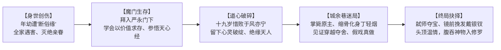
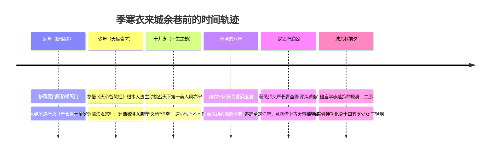

# 《剑烛大荒》第一卷《当时年少春衫薄》：人物全貌与经典场景视听美学档案

> **卷首语**：*人生若只如初见，当时年少春衫薄。*  
> **核心立论**：季寒衣最动人的地方，不是她从宗门杀出成为魔门宗主的冷酷算计，而是她明明早已学会把人心当作棋子、彻底断绝了亲缘，却偏偏在一场自己亲手布置的杀局里，重新尝到了当“妹妹”的滋味，做了一场有家的梦。

---

## 目录
1. [丁轻烟 / 季寒衣：人物灵魂全貌与核心弧光](#一丁轻烟--季寒衣人物灵魂全貌与核心弧光)
2. [来城余巷前的半生历程（生平轨迹）](#二来城余巷前的半生历程生平轨迹)
3. [核心人物外貌与服饰造型标准（Character Design）](#三核心人物外貌与服饰造型标准character-design)
4. [四大灵魂场景分镜与视听构图（Key Scenes & Environments）](#四四大灵魂场景分镜与视听构图key-scenes--environments)

---

## 一、 丁轻烟 / 季寒衣：人物灵魂全貌与核心弧光

### 1. 核心性格矛盾：残忍与可爱皆是真实
- **在成为“九恶妖女”之前，她也曾是某个人的孩子**：
  她曾经历过魔门最酷烈的“断俗缘”——不是出家，而是被师门彻底斩尽家人亲眷，使其孤立无援、孑然一身。为了在残酷的绝圣道生存，她必须学会迎合毁灭她家庭的师父，必须将情绪抹杀，必须证明自己的不可替代。这种极端的童年，塑造了她对《天心智慧经》（操纵人心、遮蔽记忆）的极致领悟——**一个曾经被彻底夺去人生掌控权的孩子，最终把掌控他人心灵变成了武器。**
- **镜子里的对照：齐潇湘（刘玉藻）vs 季寒衣**：
  - 假娘亲齐潇湘（绝圣道高手）被季寒衣从魔窟救出，终日抄佛经、以善行消解心障，却在船舱里残忍掐死对自己动真情的假丈夫邱辰，冷笑着宣称“善良的我早死在魔窟里了”。她用苦难为自己的恶毒辩解。
  - **季寒衣截然相反**：她从不为自己的杀戮辩白，她掌毙原主丁松言、逼杀师父严长青，狠辣绝伦；但她也是那个真正把齐潇湘拉出魔窟的救命恩人，是在城余巷里会因为二哥一句关心而泛起笑意的小妹。她的心硬到可以踩着尸山血海前进，却依然保留着喜欢一根两钱银子小钗子的温度。

### 2. 无法言说的秘密：三个噩梦与一场誓言
大乱前夜，隔着薄薄的破麻布屏风，她假借撒娇之口说出的三个噩梦，是她整部小说最接近真实的瞬间：
1. **第一个梦**：搬回大宅院，爹娘、兄长全死在血泊中，只剩她自己。（影射童年灭门“断俗缘”的创伤记忆）
2. **第二个梦**：娘亲杀了大哥和爹，二哥不要她了。（预示丁家伪装的家庭即将在寿宴厮杀中灰飞烟灭）
3. **第三个梦**：她一直坐在屋里等二哥来讲故事，一直等，屋外很黑，窗上有血，二哥始终没有来。（最脆弱的心事：害怕失去那个唯一不计利益待她好的二哥）
- **那场誓言**：她执拗地要丁松言发誓“绝不会死、绝不抛下小妹，去哪都带着小妹”。那不是法术契约，而是一个自幼失去家人的灵魂，在梦醒之前向命运偷来的一句安慰。

---

## 二、 来城余巷前的半生历程（生平轨迹）

1. **魔门崛起**：出身邪魔二十一道之上九道【绝圣道】。十余岁便跨过锻体炼气、直接成就法境宗师，行事肆意狡黠、杀人无算，被江湖评书冠以“九恶妖女”凶名。
2. **道心裂痕**：十九岁心高气傲登门挑战五圣宗天才风亦宁，被风亦宁以“义枪”与“信拳”正面破去“易天变地神功”。因功法讲究“以己心印天心”，己心受挫留下破绽，导致武道从此停滞。
3. **死结与生路**：风亦宁闭死关香消玉殒，洗刷心魔的希望彻底断绝；唯有通过古老神物（天帝秘宝或饕餮传承）重塑肉身窍穴，方能打破天人门槛。得知师父严长青携浑沌遗骸潜逃，一路追踪至定江府甄家。
4. **破庙杀人**：原身丁松言因恐慌试图出逃，季寒衣于城外破庙一掌震断其心脉脑髓；随后缩骨改容扮作少女丁轻烟，却当场目击主角丁松言穿魂夺舍、死而复生。

---

## 三、 核心人物外貌与服饰造型标准（Character Design）

### 1. 丁轻烟（少女伪装形态）
* **年龄视觉**：14~15 岁，身形娇小，骨骼尚未完全舒展，带有少许青涩感。
* **面部五官**：肌肤白嫩如初雪凝脂，鼻梁小巧挺拔，眼眸黑白分明清澈如泉水；未施粉黛，干净出尘。
* **发型发饰**：头梳两只娇俏灵动的**双螺髻**，发间散落几缕未束紧的细碎青丝。发髻侧方插着一根**二钱银子的素银钗**（做工精细，无多余珠花宝石）。
* **服饰配色**：
  * **上装**：葱白底色、绣暗银花边的**直领对襟短衫袄**。
  * **下装**：**鹅黄色轻薄罗裙**，裙裾微扬，脚踩青素薄底布鞋。
* **神态特质**：起猛了会皱着鼻头委屈呼痛“腿麻了”；拿着铜镜偷瞄银钗；与哥哥拌嘴时腮帮微鼓、笑起来两腮漾出浅浅梨涡。

### 2. 季寒衣（魔门宗主本相形态）
* **年龄视觉**：20 余岁成熟曼妙的绝代佳人。
* **面部五官**：容貌秀美绝伦，五官完全长开。纯净与妖媚同时停留在这张脸上毫无滞涩；唇若涂丹微泛晶莹，眼眸转动间宛若秋水生波，含笑中透着刺骨的冰凉。
* **身段形体**：骨骼舒展拔高，身形婀娜起伏，修长动人，举手投足间带着令天下宗师窒息的无形压迫感。
* **服饰发式**：
  * **衣服**：同样穿着那套**葱白短衫与鹅黄罗裙**，却被成熟丰盈的身段撑得仪态万方、艳光四射。
  * **发式**：如墨长发披散至腰际，仅用一条**素白丝帕**在脑后微束。大江楼船上，她重新梳挽起一丝不苟的云髻，并亲手将**素银钗**推入发间。

### 3. 丁松言（主角）
* **年龄形体**：约 20 岁，身长近一米八，骨架挺拔清瘦，带有久病初愈的沉静感。
* **服饰特征**：一袭洗得微旧的**偏月色青布襕衫**，腰系缁色布带，脚着千层底布履；落魄中保留着几分读书人的整洁。
* **面部气质**：眉峰微蹙，眼神深邃敏锐，带有前世商场磨砺出的世故隐忍与察言观色；外表温文尔雅，实则惜命警惕。
* **神物觉醒异象（第60章）**：
  * 背部霍然张开**四只色彩各异的虚幻羽翼**（春绿萌动、夏日烈火、秋金天高、冬雪冰封）；
  * 眉心正中浮现出一团幽暗深邃、缓慢旋转并纳五官于其中的**混沌涡流印记**。

### 4. 严长青（严永，师父）
* **外貌特征**：容貌清癯干瘦，两鬓苍白如覆霜雪；头戴一顶古旧的**黑色华阳巾**。
* **残躯异象**：**双臂自肩头齐齐削断，双腿自膝盖处齐截断去**；残躯瘫坐在黑漆太师椅上，空荡荡的袖口裤管垂落。
* **死相神物**：胃袋翻裂，内中延伸出一团如拳头大小、不断吞吐暗红火光与幽暗雾气的**黄色囊状浑沌帝江遗骸**。

---

## 四、 四大灵魂场景分镜与视听构图（Key Scenes & Environments）

### 场景一：【破庙晓梦】—— 虚实交汇与梦醒初遇（第 1 章）
* **环境空间**：
  * 定江府外荒郊的倾颓古庙。泥塑神像残缺断臂，蛛网结于梁木之间，青石地砖缝隙中野草萋萋。
  * 清晨的第一缕朝阳伴随着微尘，从坍塌的殿顶与破窗斜射而入，形成神圣而荒凉的丁达尔光束。
* **镜头调度**：
  * **全景**：幽冷黑暗的阴冥梦境幻化散去，青衫书生丁松言靠在红漆斑驳的木柱旁缓缓睁眼。
  * **特写**：少女丁轻烟蹲在丁松言身前，双手托腮，双螺髻上染着晨光，眼神关切纯净。
  * **中景转折**：少女起身拉哥哥，却因蹲久而整个人僵住，苦着脸软语喊“腿麻了”，晨曦中尘埃飞舞，晨鸟“呖——”鸣远去。

### 场景二：【城余巷丁家西厢房】—— 隔帘夜话的偷来温存（第 4、5、20 章）
* **环境空间**：
  * 低矮狭小的民房厢房，泥土地面泛着微潮。院外有一株老榆钱树，夏夜凉风吹得树影在窗纸上摇晃。
  * 屋内核心视觉线：**一扇由粗糙木条与泛黄粗麻布简易拼成的屏风**，将房间划分为内外两室。
* **光影氛围**：
  * 木桌上一盏青铜油灯如豆，散发着橘暖色的微弱光亮。
  * 屏风那侧，少女抱着粗布薄被侧卧，剪影纤细柔美；屏风这侧，书生伏案提笔研墨，窗外蝉鸣蛙叫连绵，伴着低回温和的《白蛇传》故事声。

### 场景三：【甄府黑牢对峙】—— 假面撕碎的“师慈徒孝”（第 51 章）
* **环境空间**：
  * 甄府深处地下黑水斗室。石壁泛青渗出阴冷水滴，四周立着挂满锈蚀铁链的石柱，空气浑浊逼仄。
  * 中心处：残废的严长青瘫坐于宽大黑太师椅上，油灯拉长了畸形短影。
* **镜头调度**：
  * 沉重的黑玄铁门发出“扎扎”巨响被推开。
  * 火光骤亮处，丁轻烟盈盈走入，随着步伐迈进，其骨骼发出微弱轻响，身形拔高舒展，自十四五岁少女化作青丝披肩、惊艳天下的绝圣道妖女季寒衣。
  * **特写**：严长青浑浊老眼瞬间充满难以遏制的恐惧；季寒衣嘴角噙着如水浅笑：“师父，徒儿来救您了。”

### 场景四：【大江楼船镜前挽发】—— 银钗与野心的终极定格（第 60 章）
* **环境空间**：
  * 顺江东下的巨型豪华楼船顶层舱房。两扇雕花木窗大敞，外面是浑浊浩荡的大江波涛与极目远舒的苍茫水天，岸边古城正渐渐缩为天际黑线。
* **核心电影分镜**：
  1. **【镜前独坐】**：季寒衣端坐于红木梳妆台前，注视着面前冰冷透亮的西洋玻璃大镜。房门紧闭，外界的纷扰血雨全被隔绝。
  2. **【素钗入鬓】**：她极细致、极轻柔地挽起如瀑青丝，取出那一枚仅值两钱银子、没有半点灵气珠花的素银钗，缓缓斜插于发髻之侧；她左右侧头轻照，唇角微微泛起一抹独属于“丁轻烟”的嫣然笑意。
  3. **【吞噬神物】**：笑容收敛，神情重回君临天下的坚毅与冷酷。她轻抬如霜皓腕，将那一整团散发着远古混沌神威的黄色帝江遗骸直接纳入唇中咽下。
  4. **【远景空镜】**：楼船劈波斩浪驶入茫茫江心水雾，头戴素银钗、身怀大荒至宝的季寒衣凭栏而立，迎向无尽风浪。
