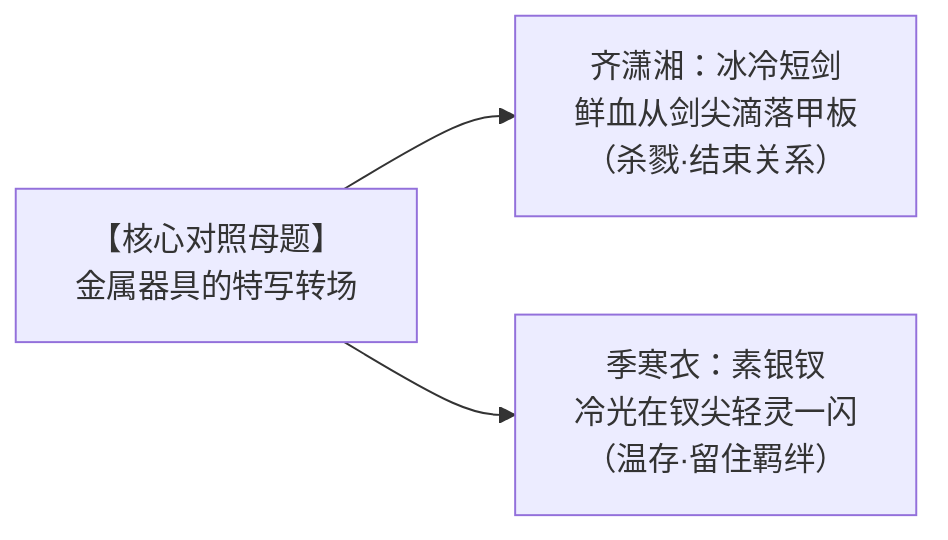

# 《幻梦》微电影视听分镜与剧作工程脚本

> **片名**：《幻梦》  
> **体裁**：4~6 分钟叙事概念短片 / 影视级 AI 视频生成分镜脚本  
> **核心戏剧核**：齐潇湘用言语告诉世界她已成了恶鬼；季寒衣不着一字，只用一根银钗证明那个干净的少女从未真正死去。  
> **全片时长**：约 5 分钟（280~320 秒）  
> **调色方案**：冷峻青灰（现实·楼船） $\longleftrightarrow$ 暴烈高反差血火（前半生） $\longleftrightarrow$ 橘暖油灯与树影（城余巷）

---

## 视觉与声画核心母题设计（Visual & Audio Motifs）

* **声音桥梁（J-Cut / L-Cut）**：齐潇湘在船舱里的独白，作为刺入季寒衣前半生的引线；第三个梦里屏风后少女轻颤的“二哥？”，直接跨越时空回荡在现实的楼船舱房中。
* **留白原则**：结尾坚决不念旁白，不煽情，不解释。让短剑与银钗的构图语言、镜中挽发的一抹浅笑，承载整部短片的灵魂千钧。

---

## 第一幕：她说自己早就死了（现实 · 楼船 · 0:00 - 1:00）

> **影调**：暗青灰冷调、潮湿的水汽阴影、江浪拍击木船的低沉钝响。

### 镜头 01（特写 · 慢镜头）
* **画面**：极近景。一柄泛着寒光的精钢短剑剑尖微颤，一滴黏稠的暗红鲜血拉丝下坠，“啪嗒”一声砸碎在深灰色的湿漉甲板木纹缝隙里。
* **声音**：大江波涛的闷响，混杂着濒死之人喉咙里最后一声模糊倒抽气的声音。
* **画面变化**：镜头极缓慢上摇，露出邱辰圆睁空洞的双眼与瘫倒的粗壮身躯。

### 镜头 02（中景 · 稳定推镜）
* **画面**：齐潇湘（刘玉藻）背对逆光的舱门，正用一块干净的白帕缓缓擦拭短剑上的血迹。她的面容清冷漠然，眼神没有一丝波动。
* **台词（齐潇湘·轻声独白）**：  
  *“邱辰以为，那大半年里，我是真的动了心思……”*  
  *“可他不知道……曾经那个善良、柔弱、值得旁人怜惜的齐潇湘……”*

### 镜头 03（全景到特写 · 镜头平移）
* **画面**：齐潇湘收剑入鞘，将白帕随手丢在尸体身侧。镜头顺着幽暗狭窄的木质过道缓缓平移滑轨，越过厚重的隔板，推入隔壁那间安静得落针可闻的宗主上房。
* **台词（齐潇湘声音在过道回荡）**：  
  *“……早在那一年被卖入魔窟时，就死得干干净净了。”*

### 镜头 04（背影特写 · 视觉悬念）
* **画面**：逆着大敞的雕花木窗，江面上惨白的天光勾勒出一个女子的背影。  
  **然而，她身上穿的，赫然是一身与魔门煞气格格不入的素净衣裳——葱白绣暗银花边的直领短衫，鹅黄色的轻薄罗裙，一头乌黑的长发松松散在肩背。**
* **细节**：听到隔壁那句“死得干干净净了”，窗前的少女背影没有回头，只有搭在窗棂上的手指微微蜷曲了一下。
* **台词（齐潇湘画外音，如梦呓般在虚空中轻响）**：  
  *“如今活下来的，不过是一具懂得利用别人怜悯的恶鬼。”*
* **视听转场**：江面忽然刮过一阵凄厉的阴风，窗外日光骤暗，惨白电光刹那撕裂长空，雷声轰鸣中，直接转入季寒衣的记忆深渊。

---

## 第二幕：季寒衣的前半生（回忆 · 暴雨与火光 · 1:00 - 2:20）

> **影调**：低饱和度、泥泞雨夜的深蓝与冲天火光的焦黄对撞。

### 镜头 05（超现实抽象记忆 · 断俗缘）
* **音效**：雷暴、暴雨倾盆、门窗坍塌碎裂的巨响。
* **画面**：深沉如渊的雨夜大院。漫天血雨打在泥水里泛起层层猩红泡沫。一个约莫七八岁的小女孩蜷缩在廊柱阴影下，双手拼命往前伸，地上是数道倒在血泊中动也不动的模糊身影。
* **微观处理**：黑袍人（严永）如死神般的阴影笼罩而下，冰冷苍老的手掌强行遮住了女孩的眼睛。世界陷入纯黑。

### 镜头 06（对照蒙太奇 A · 十六岁的厮杀）
* **画面**：昏暗逼仄的绝圣道地穴。剑刃破肉的闷响。十六岁的季寒衣浑身是血，持剑的手剧烈颤抖，在她脚下，是四五个同样穿着魔门弟子黑袍的少年尸骸。
* **细节**：她单膝跪地，死死按住怀中散发着异样金光与肉香的神兽血肉，大口喘息。抬起头时，少女的脸上溅着两道刺目的血痕，眼神凶狠、机警、像一只在狼群中杀出血路的幼兽。

### 镜头 07（对照蒙太奇 B · 十六岁的凤凰）
* **画面**：画风骤转为堂皇明净的高山云海。阳光万丈，五圣宗山门钟声悠扬。  
  同样十六岁的风亦宁白衣胜雪，负赤金长枪立于云巅。她周身环绕着纯净璀璨的金色凤凰虚影，山道两侧，数百名正道少年英豪仰头凝望，眼中尽是倾慕与虔诚。

### 镜头 08（十九岁的决战 · 渴望与不甘）
* **环境**：荒原古道，黄昏残阳如血。
* **特写**：十九岁的季寒衣双手结印，《天心智慧经》引动周遭天象扭曲，狂风掀起她的衣袍。她的双眸中，第一次爆发出强烈到近乎偏执的求胜欲——那是对“凭什么你能拥有一切”的终极质问。
* **交锋（慢动作）**：
  风亦宁长枪刺出，不带一丝阴诡机巧，唯有浩荡沉凝的“义枪”与重如泰山的“信拳”。
  金光撞碎了季寒衣的幻术屏障。
  “咔嚓”一声清脆的心境碎裂声（玻璃裂开音效）。

### 镜头 09（败局与背影）
* **画面**：季寒衣跌倒在地，唇角淌下鲜血。
* **处理**：她没有嚎啕大哭，没有愤怒嘶吼。她只是用手背重重擦去唇边的血渍，死死盯着风亦宁白衣长枪、飘然离去的背影。风吹乱了季寒衣额前的碎发，她孤身一人跪在空旷的荒原尽头，久久未动。
* **台词（齐潇湘的画外音再次如同幽灵般切入）**：  
  *“……在这个世道，谁会真的在乎你？”*

---

## 第三幕：她又做了一次妹妹（回忆 · 橘暖与油灯 · 2:20 - 4:10）

> **影调**：饱和度回升，泛黄的纸墨暖色、透过榆钱树叶洒下的斑驳碎金。全片节奏骤然放慢。

### 镜头 10（初醒与市井晨光）
* **画面**：定江府破庙。一缕柔和的晨曦从塌陷的屋顶倾泻而下。
* **动作**：双螺髻、十四五岁模样的丁轻烟蹲在刚睁眼的丁松言面前。少女伸手想拉他，刚站起一半突然定格，小脸皱成一团，苦兮兮地拍着腿：“哎呀，腿麻了……”
* **情绪**：丁松言无奈摇头的神情映在少女清澈无邪的瞳孔里。那是整部短片里，第一次出现干净的笑意。

### 镜头 11（城余巷的夏日琐碎 · 蒙太奇）
* **镜头 A**：夏日老榆钱树下，丁松言伏案写字，丁轻烟坐在小板凳上捧着半只香酥鸭，偷偷撕下一小块鸭肉塞进哥哥嘴里，笑得眼睛弯成了月牙。
* **镜头 B**：喧闹的市集小摊前，丁松言把一根用粗草纸裹着的素银钗塞到她手里：“给你就拿着，不收我拿去送给巷口的阿花。”丁轻烟气鼓鼓地举起小粉拳作势要打。
* **镜头 C**：狭窄的堂屋内，丁轻烟背着哥哥，独自举着一面小铜镜，翻来覆去地端详发髻上的那根素钗，唇角掩不住地雀跃飞扬。

### 镜头 12（隔帘夜话 · 唯一的心事）
* **空间**：深夜西厢房。一盏如豆的油灯散发着昏黄的微光。泛黄的破麻布木条屏风立在屋中。
* **画面**：丁松言伏在桌上研墨写话本；屏风后，少女蜷缩在薄被里，投下一道纤细单薄的剪影。
* **声音**：屏风后传来轻哼的小调：“青城山下白素贞……”随之是少女轻柔的央求与二哥无奈温和的说书声。

### 镜头 13（全片唯一的超现实段落 · 第三个梦）
* **视觉异化**：暖色的油灯火苗突然剧烈跳动，骤然泛起一层刺骨的青冷。
* **声音**：屏风后传来少女极度压抑、带着哭腔的抽泣声。
* **画面转换**：丁松言的身影在桌前如青烟般寸寸瓦解消失，笔落宣纸，浓墨晕开如血。桌案腐朽，空无一人。
* **空镜特写**：西厢房陷入绝对死寂的黑暗。屏风后的油灯彻底燃尽，冒出一缕青烟。
* **画外音（少女极微弱、颤抖的声音，带着深入骨髓的无助）**：  
  *“……二哥？”*  
  （静默两秒，唯有风穿过破窗的呼啸）  
  *“……二哥？”*

### 镜头 14（时空跨越的声音连接）
* **声音**：那声带着哭腔的“二哥？”，直接跨越了时空壁垒，清清楚楚地响在了现实的船舱之中！

---

## 第四幕：一个人，两种人生（现实 · 楼船起航 · 4:10 - 5:00）

> **影调**：从肃杀的阴冷青灰，逐渐过渡到大江破晓、天地浩荡的自然暖调。

### 镜头 15（特写 · 回到现实）
* **画面**：现实中的楼船舱房。逆光站在窗前的季寒衣，眼睫极其轻微地颤抖了一下，眼底的一丝恍惚转瞬被宗主的清冷压下。
* **动作**：身后的齐潇湘低头行礼，脚步声渐行渐远，沉重的木门“吱呀——咔哒”一声合拢，彻底关上。

### 镜头 16（手部构图转场 · 核心母题闭环）
* **前接特写**：闪回半秒齐潇湘杀死邱辰时，短剑冰冷刺骨的金属反光。
* **当前特写**：镜头落回季寒衣白皙纤细的掌心——她缓缓摊开五指，掌中托着的，赫然是那根**没有珠花、做工微粗、只值二钱银子的素银钗**。晨曦掠过窗棂，素银钗在江光下轻轻一闪。

### 镜头 17（镜前挽发 · 封神长镜头）
* **机位**：越肩镜头，对着面前一面透亮的西洋玻璃大银镜。
* **环境音**：没有任何多余的宏大配乐，只有苍茫雄浑的江水拍岸声、帆索在风中的轻响。
* **表演细节**：
  1. 季寒衣平静坐下，修长的指尖穿过长发，动作耐心、缓慢而轻柔地挽起如墨青丝。
  2. 镜中映出的是一张绝代倾城的宗主面容，眼神历经千帆，杀伐果决。
  3. 她举起素银钗，极郑重地推进发髻侧面。
  4. 左右微微偏头照了照，**镜中的女子唇角轻挑，忽然展颜一笑——那一抹笑意极纯、极暖，与当年城余巷窗前照铜镜的丁轻烟毫无二致。**

### 镜头 18（吞噬神物 · 走向修罗）
* **特写**：笑意敛去，眼神重化为深不可测的九渊寒潭。
* **动作**：她霍然起身，左手轻抬，毫不犹豫地将那团散发着远古金光与玄黑雾气的黄色帝江遗骸塞入口中吞下。
* **视觉焦点**：**摄像机焦点自始至终牢牢锁定在她发间那根轻轻摇颤的素银钗上**，神物的刺目光芒仅仅作为背景虚焦。

### 镜头 19（大远景 · 终局定格）
* **画面**：镜头从舱房骤然拉出，飞升至九天之上。
* **景象**：烟波浩渺，群山如黛，滚滚大江奔流向东。一艘破浪起航的孤舟楼船正扬起白帆，驶向无边无际的苍茫大荒。
* **声音**：大江涛声由近及远，配乐在此刻响起一段空灵幽远的竹笛与胡琴，伴着一声极轻、极淡的少女哼唱（《青城山下白素贞》的散落余韵），渐弱直至虚无。
* **画面**：全黑淡出。**（无文字旁白，全片终）**

---

## 编剧与导演核心执行备忘（Director's Notes）

1. **去旁白化与视听纯度**：
   全片除齐潇湘开篇的一段冷酷自白与第三幕屏风后的一声“二哥”外，**全片 0 句旁白**。所有的情绪全靠蒙太奇与物件对照（短剑 vs 银钗）推动，将解释权完全留给观众的泪腺。
2. **AI 生成与白模资产制作指导**：
   - **第一幕（楼船）**：利用已装载的 Blender 5.2，搭建船舱中景木质框架，设置单一冷色主光源与景深（DOF），输出给即梦 Seedance。
   - **第二幕（风亦宁决战）**：大荒开阔地形白模，运镜拉升至仰角，强化长枪金光与破碎意象。
   - **第三幕（西厢房）**：精确摆放 1.75m 比例尺与粗布屏风，Workbench 模式打单盏点光源（油灯），渲染出具有物理遮挡的皮影式侧卧剪影。
   - **第四幕（镜前特写）**：重点调试手部持钗动作轨迹与面部微笑权重，首帧采用高精度定妆照垫图约束。
